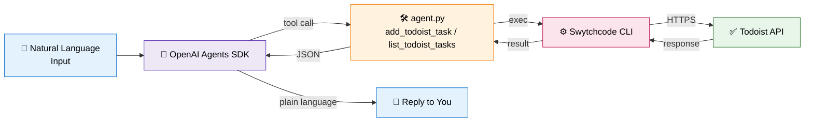

<div align="center">

# 🤖 Todoist Agent

### Talk to your task list like a person.

A single-API AI agent that manages your **Todoist** tasks through natural language —
built with the **OpenAI Agents SDK** and **Swytchcode**.

<br/>


<br/>

> *"add a task to review the PR by tomorrow"* — that's literally all you type.

<br/>

[⚡ Quick Start](#-quick-start) · [🧠 How it works](#-how-it-works) · [🛠️ Setup](#️-setup) · [💬 Usage](#-usage) · [🔐 Security](#-security)

</div>

---

## ✨ What is this?

**Todoist Agent** is a thin, smart layer between you and your Todoist. Instead of
clicking through menus, you just... talk to it. The agent figures out *what you
want*, picks the right tool, and gets it done.

| ❌ Without the agent | ✅ With the agent |
|---|---|
| Open Todoist → click + → type title → set date → pick project → save | *"remind me to review the PR tomorrow"* |
| Navigate filters, scroll, sort by due date | *"what's on my plate today?"* |
| Manually update priorities | *"bump the auth task to P1"* |

No UI. No friction. Just intent → done.

---

## 🧠 How it works

<div align="center">



</div>

### 🔁 The flow in plain English

1. **You** type something like *"add a task to review the PR by tomorrow"*.
2. The **OpenAI Agents SDK** reads it, decides the intent, and picks a tool.
3. The tool (`add_todoist_task` or `list_todoist_tasks`) hands off to **`swytchcode exec`**.
4. **Swytchcode** handles auth, retries, and schema validation — and is the **only** thing that talks to Todoist.
5. The result flows back through Swytchcode → tool → agent → you, in natural language.

> 🛡️ **No direct HTTP calls to Todoist happen in this codebase.** Swytchcode is the only bridge.

---

## ⚡ Quick Start

For the impatient (full details below):

```bash
# 1. Install + login
npm install -g swytchcode
swytchcode login
swytchcode init --editor none --mode production
swytchcode get todoist

# 2. Get the canonical IDs
swytchcode list methods todoist
# → paste them into agent.py

# 3. Enable the tools
swytchcode add <create_task_canonical_id>
swytchcode add <list_tasks_canonical_id>

# 4. Set up Python
python -m venv .venv
source .venv/bin/activate   # Windows: .venv\Scripts\activate
pip install openai-agents
export OPENAI_API_KEY=sk-...   # Windows: setx OPENAI_API_KEY "sk-..."

# 5. Run it
python agent.py "what's on my todo list today?"
```

---

## 🛠️ Setup (detailed)

### Step 1 — Install the Swytchcode CLI

```bash
# Option A: via npm
npm install -g swytchcode

# Option B: via install script
curl -fsSL https://cli.swytchcode.com/install.sh | sh
```

Then authenticate and initialize this project:

```bash
swytchcode login
swytchcode init --editor none --mode production
swytchcode get todoist
```

### Step 2 — Find the real canonical IDs

```bash
swytchcode list methods todoist
```

Open `agent.py` and replace the placeholder values of `CREATE_TASK_TOOL` and
`LIST_TASKS_TOOL` with the canonical IDs that command actually prints.

### Step 3 — Enable those tools

```bash
swytchcode add <create_task_canonical_id>
swytchcode add <list_tasks_canonical_id>
```

### Step 4 — Wire up your Todoist auth

Check what the tool expects:

```bash
swytchcode info <create_task_canonical_id>
```

Get a Todoist API token from **Todoist → Settings → Integrations → Developer**,
and provide it however the `info` output indicates (commonly an
`Authorization` header or token input passed at exec time).

> 🧪 **Sanity check before running the agent for real:**
> ```bash
> swytchcode exec <create_task_canonical_id> --dry-run --json
> ```

### Step 5 — Install Python dependencies

```bash
python -m venv .venv
source .venv/bin/activate              # macOS / Linux
.venv\Scripts\activate                 # Windows

pip install openai-agents
export OPENAI_API_KEY=sk-...           # macOS / Linux
setx OPENAI_API_KEY "sk-..."           # Windows
```

---

## 💬 Usage

```bash
# Add a task
python agent.py "add a task to review the pull request by tomorrow"

# List today's tasks
python agent.py "what's on my todo list today?"
```

### 🎯 Example session

```
$ python agent.py "add a high-priority task to call mom tomorrow at 6pm"

🤖 Agent: Got it. I've added this task to your Todoist:
   • Title: Call mom
   • Priority: P1 (High)
   • Due: Tomorrow 18:00
   • Project: Inbox
```

---

## 📁 Project structure

```
todoist-agent/
├── 🐍 agent.py         # Agent definition and tools
├── 📖 README.md        # You are here
├── 📦 requirements.txt # Python dependencies
└── 🙈 .gitignore       # Keeps secrets & build junk out of git
```

---

## 🔐 Security

> 🚨 **Read this before you commit anything.**

| Secret | Where to put it | NEVER |
|---|---|---|
| `OPENAI_API_KEY` | `.env` (gitignored) or env var | ❌ Hardcode in `agent.py` |
| Todoist API token | Passed to Swytchcode at exec time | ❌ Commit to git |
| Swytchcode session | `swytchcode login` (local) | ❌ Share with anyone |

✅ **Do:**
- Use a gitignored `.env` file
- Use environment variables for CI/CD
- Rotate keys immediately if they're ever exposed

❌ **Don't:**
- Commit `.env` (GitHub will block the push via push protection — and it should)
- Print API keys in logs
- Share your `.env` file

---

## 🎛️ Modes

This agent uses Swytchcode's **`production`** mode by default (set during
`swytchcode init`). Switch to **`sandbox`** mode if Todoist's integration
supports it and you want to test without touching your real task list:

```bash
swytchcode init --editor none --mode sandbox
```

---

## 🤝 Contributing

PRs welcome! A few ideas if you want to jump in:

- [ ] Add more tools (update_task, complete_task, delete_task)
- [ ] Add a webhook listener for Todoist events
- [ ] Support multi-project queries
- [ ] Build a Slack/Telegram frontend

---

## 📜 License

MIT — do what you want, just don't blame us.

---

<div align="center">

**Built with ❤️ by [Nishant Das](https://github.com/NishantDas0079)**

⭐ Star this repo if it saved you a click or two.

</div>

